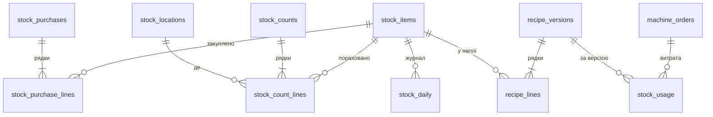

# Облік залишків

Скільки на точці й на складі зерна, молока, шоколаду, води, стаканів, кришок
і витратних, на скільки їх вистачить і що з цього коштує (власник,
18.10.2026: «знадобиться на майбутнє, поки не буду регулярно заповнювати»).
В адмінці — «Залишки» в групі «кавʼярня» (вкладки: залишки, інвентаризації,
закупки, матеріали й рецепти), рядок «запаси» на «Здоровʼї» й гроші на
«Фінансах» (`admin_panel.md`). Розрахунки — `backend/lib/src/stock.js`,
спільні для api (`routes/admin-stock.js`), scheduler (`jobs/stock.js`) і
overseer (`health.js`), тож екран і алерт рахують однаково.

## Що де лежить



- **Матеріали** (`stock_items`) — у базових одиницях: г, мл, шт (на екрані
  кг, л, шт). Пачка (`pack_size`, `pack_name`) — як купуємо, для підказок.
  `canister` — бункер Jetinno, з якого машина бере матеріал (170 — зерно,
  2 — молоко, 3 — шоколад, 1 — бункер 1, зараз із матчею, 0 — вода): за ним
  імпорт рецептів пише грами в матеріал. `per_day` — витрата незалежно від
  продажів (пакети для сміття, вологі серветки), 0 — лише за рецептами.
- **Місця** (`stock_locations`) — склад, полиці кавʼярні, бункери машини.
  Залишок облікуємо загальний: перенос зі складу на полицю його не міняє,
  місця лише для того, щоб на інвентаризації нічого не забути.
- **Закупки** (`stock_purchases`, `stock_purchase_lines`) — документ і
  рядки. Рядок — або матеріал (кількість і вартість), або інша витрата з
  категорією: CAPEX (обладнання, запуск) чи OPEX (оренда, сервіси). Інші
  витрати на склад не йдуть, зате «Фінанси» бачать усі гроші. Закупку можна
  виправити чи видалити.
- **Інвентаризації** (`stock_counts`, `stock_count_lines`) — **джерело правди**
  про кількість на мить підрахунку. Нова — лише пізніша за останню (вставлена
  посередині тихо переписала б історію); правити й видаляти можна лише
  останню, зокрема заднім числом (дата — не раніше за попередню). Часткова —
  нормально: матеріал, якого в ній немає, просто не рахували.
- **Рецепти** (`recipe_versions`, `recipe_lines`) — версіями, кожна чинна від
  `valid_from` до наступної. Рядок — скільки матеріалу на напій
  (`product_id` — номер продукту машини, `drinks.slot` числом; 0 — на кожен
  куплений напій) і яка частка покупців його бере (`take_rate`: кришку,
  мішалку беруть не всі).
- **Витрата** (`stock_usage`) — за кожним замовленням машини, за рецептом,
  **чинним на мить покупки** (власник: «потрібно враховувати рецепти станом на
  момент покупки, самі витрати логувати в таблиці, повʼязаній з
  транзакціями»). `qty` — очікувана (кількість × частка), `var` — її
  дисперсія (кількість² × p(1−p)). Тестові чашки техніка й окріп за 1 ₴ теж
  витрачають воду, зерно, стакани — вони тут є; «на кожен напій» (мішалка) —
  лише купленим напоям зі стаканом.
- **Журнал** (`stock_daily`) — по кожному матеріалу на кожну київську добу:
  розрахунковий залишок, розрахункова витрата за добу, крива прогнозу вперед
  (сукупні середнє й дисперсія на кожну з 30 діб) і «на скільки вистачить».
  `as_of` — мить, яку описує рядок: кінець доби для минулих, мить останнього
  перерахунку для сьогоднішньої.

## Розрахунковий залишок

```
залишок(t) = остання інвентаризація до t (що рахувала матеріал)
           + закупки після неї до t
           − витрата за замовленнями після неї до t
           − per_day × діб від неї
```

Без інвентаризації — від першої закупки (усе куплене вважаємо на складі).
Ні інвентаризації, ні закупки — залишок **невідомий** (не нуль): так зараз
із водою, бо бутлі в таблиці витрат не записані. Похибка розрахунку σ —
корінь із суми `var` витрати: її дає лише частка тих, хто бере (кришка
50 % — так, кришка 100 % — ні); дозування машини вважаємо точним, а розкид
помелу покриває відсотковий допуск (нижче).

## Прогноз витрати

Даних мало (продажі з 05.10.2026, кілька чашок на добу), тож модель проста й
обережна (`demandModel` і поруч):

1. **Напої за добу** — куплені (не тестові) продукти з меню за останні 56 діб.
   День тижня — середнє дня, стягнуте до загального двома уявними днями:
   інакше два понеділки зробили б із понеділка свято. Рівень і тренд —
   зважена регресія (свіжі доби важать більше, піврозпад 21 доба); тренд
   стягнутий до нуля коефіцієнтом n/(n+28), поки історії мало.
2. **Розкид** — надрозсіяний Пуассон: φ = наскільки доби розкидані сильніше,
   ніж у Пуассона (щонайменше 1). Дисперсія за H діб = φ·Σμ плюс
   невизначеність рівня й тренду — тому прогноз на місяць ширший, ніж на тиждень.
3. **Частки напоїв** — за останні 28 діб, стягнуті до рівних (α = 2 уявні
   покупки).
4. **Витрата матеріалу** = напої × витрата на напій (частки × рецепт) +
   щодобова. Дисперсія суми випадкової кількості напоїв:
   E[N]·Var(c) + Var(N)·E[c]².

Результат — середнє ± σ на кожну добу вперед і «на скільки вистачить»: за
середнім і **з імовірністю 90 %** (z = 1,28). Сьогоднішня крива йде від цієї
миті: продані вже сьогодні напої з першої доби віднімаються. Модельовані
(прогноз) і фактичні (вже продані) покупки так і складаються: до цієї миті —
факт у залишку, далі — модель.

Чого модель свідомо не робить: години доби (для «на скільки діб вистачить»
вони не важать), частку покупців з відео (поки норми самообслуговування
задаються руками й перевіряються інвентаризацією), сезонність довшу за
тиждень (історії немає).

## Інвентаризація: розрахунок, прогноз, факт

По кожному порахованому матеріалу (`compare` у `admin-stock.js`):

- **очікувано** = попередня інвентаризація (або перша закупка) + закупки −
  витрата за рецептами за період, ± σ;
- **факт** — сума по місцях (по кожному — у підказці);
- **різниця** = факт − очікувано. Допуск — більше з: 5 % розрахункової
  витрати, 2σ і невеликої абсолютної межі (20 г, 1 л, 2 шт — пара одиниць,
  що їх не відрізнити при підрахунку). Нижче допуску — **перевитрата**
  (червоне: витрачено більше, ніж мало б за продажами й рецептами), вище —
  «лишилось більше» (рецепт завищує витрату чи закупку не внесено);
- **прогноз за X днів до** — з журналу: залишок на кінець доби X днів тому +
  закупки після нього − прогноз витрати на час, що минув. X — 7 днів
  (`STOCK_COMPARE_DAYS`), на сторінці інвентаризації міняється. Поруч —
  розрахунок на ту мить. Журнал не переписується, тож це справді те, що ми
  обіцяли тоді, а не підігнане заднім числом;
- **на напій: факт / норма** — скільки матеріалу пішло на один куплений напій
  насправді й за рецептом. Для кришок і витратних це й є перевірка норм
  самообслуговування: «кришку бере 100 %» з фінмоделі проти фактичних 70 %.

Матеріал без норми (ні в рецепті, ні щодобової) — «без норми»: різниці немає з
чим порівнювати, але фактична витрата й частка на напій видно — з них норму й
задають.

## Здоровʼя й фінанси

**Рядок «запаси»** на «Здоровʼї» (overseer, компонент `stock`): зелений, коли з
імовірністю 90 % вистачить на `STOCK_COVER_DAYS` днів (типово 14 — правило
регламенту «запас ≥ 2 тижнів») по кожному матеріалу з нормою й відомим
залишком. Червоний — перелік тих, кому не вистачить, із днями. Обліку ще
немає — немає й рядка.

**«Фінанси»** (`/admin/finance`):

- собівартість = витрата за замовленнями × середня ціна закупки матеріалу
  (Σ вартість / Σ кількість за всі закупки) + щодобова. Подарунки (нульова
  ціна) у знаменнику: собівартість чашки з подарованого зерна справді нижча.
  Тестові чашки й напої власника — теж собівартість, хоч виручки з них немає;
- валовий прибуток = виручка − собівартість, маржа — його частка у виручці;
- вартість запасів — розрахунковий залишок × середня ціна, на кінець доби з
  журналу;
- закупки матеріалів, OPEX і CAPEX — за днем отримання;
- **податок і еквайринг** — OPEX, який ніхто не вносить: подання `opex_auto`
  рахує його з кожного чека, як сплачений одразу (власник, 18.10.2026: при
  сплаті податків його не відокремиш — ФОП платить їх разом з іншою
  діяльністю). Податок — 5 % + 1 % військового збору з усієї суми чека,
  еквайринг — 1,3 % від оплати карткою (перевірено власником). Ставки — у
  `opex_rates` з датою, з якої діють: зміниться ставка — новий рядок, минулі
  доби лишаться за старою. Чеки власника теж: як і собівартість його чашок,
  податок і комісія з них — справжні гроші. ЄСВ сюди не йде — в
  управлінському обліку це «інша діяльність» ФОП;
- операційний прибуток = валовий − OPEX (внесений + податок і еквайринг);
- **заплановані платежі** — закупки з датою в майбутньому. Так внесено
  комісію за розстрочку на машину: тіло (106 856 ₴) — CAPEX у день доплати
  05.10.2026, бо машина вже наша, а комісія (2 030,26 ₴ на місяць) — OPEX у
  день кожного з 12 платежів. До свого дня такий рядок — не витрата: ні в
  періоді, ні в окупності, лише в таблиці «Заплановані платежі»;
- окупність — з початку продажів, а не за період: (виручка − собівартість −
  OPEX, з податком і еквайрингом) / CAPEX.

## Налаштування

`STOCK` у `backend/lib/src/stock.js`; два періоди — зі змінних оточення
(власник: «або інший фіксований період з конфіга»):

| Що | Де | Типово |
|---|---|---|
| запасу вистачить на N днів | `STOCK_COVER_DAYS` | 14 |
| прогноз за X днів до інвентаризації | `STOCK_COMPARE_DAYS` | 7 |
| допуск розбіжності | `marginPct`, `marginSigma`, `marginAbs` | 5 %, 2σ, 20 г / 1 л / 2 шт |
| історія попиту, частки напоїв | `historyDays`, `mixDays` | 56, 28 діб |

## Рецепти з машини

Склад напою (грами, вода) машина знає сама, а сервіс її рецептів не чіпає
(`jetinno.md`). Тому «підтягнути з машини» — це резервна копія рецептів:
`upload` з `uptype` `recipe` кладе в `/packet` zip `Recipe_Product_Zip_…`
(руками — `jetinno/scripts/machine-names.mjs`; копії лежать у
`jetinno/backups/`, поза git). У «матеріалах й рецептах» → «Імпорт із машини»
цей zip обирають як є (адмінка розбирає його сама, `zip.js`) або два файли з
нього. Імпорт:

- `*.product` дає номер продукту, назву й ключ рецепта, `*.recipe` — кроки:
  бункер, вода (мл), інгредієнт (`gradientWeight`, г). Грами йдуть у
  матеріал за бункером, вода — сума води всіх кроків;
- пакування й «на кожен напій» машина не знає: вони переходять із чинної
  версії, а новому продукту — стакан за розміром у меню (`drinks.cup`) і
  кришка з тією ж часткою;
- спершу показує, що зміниться, і лише тоді створює версію від обраної дати;
  такі самі рецепти — версія не потрібна. Версія заднім числом одразу
  перераховує витрату замовлень після неї.

Норми самообслуговування (кришка, мішалка, цукор, серветки, трубочки) — там
само, окремою формою; збереження — теж нова версія від дати.

## Стартові дані (18.10.2026)

- **Закупки** — усі 29 рядків «Витрати — ФАКТ» з `Zernova_accounting.xlsx`
  (власник: «заносити все»): 108 482 ₴, з них 23 477 ₴ матеріали й 85 005 ₴
  CAPEX (передоплата за машину, пошук локації, кабелі й кронштейн,
  фіскалізація, лого, дозатор сиропу). Час отримання — полудень дати з
  таблиці. Подарунковий набір Zernova до стартової закупки (3 пачки кави, 2
  молока, 1 шоколаду — «CAPEX план-факт», `ІНВЕНТАРИЗАЦІЯ.md`) — окремою
  закупкою з нульовою ціною.
- **Пачки**: кава й шоколад BREWMIST — 1 кг, молоко BREWMIST Milk 100% —
  900 г (прайси FastKava й brewmist.com.ua), цукор — 200 стіків по 5 г,
  матча — 1 кг (власник). Стакани — тиражі друку по 500.
- **Рецепти, версія 1** — з резервної копії машини 11.10.2026 (копія 08.10
  така сама, раніших не робили, тож чинна від запуску). Перевірено: імпорт цієї
  ж копії дає нуль змін. Стакан — за меню (S — еспресо, лунго, подвійний; M —
  кортадо, американо; L — решта), кришка на M і L й мішалка на кожен напій —
  частка 1, як у фінмоделі (собівартість чашки рахує кришку й мішалку на
  кожну) — до першої інвентаризації, яка покаже справжню частку. Цукор,
  серветки, трубочки — без норми: моделі для них немає.
- **Інвентаризація 05.10** (`ІНВЕНТАРИЗАЦІЯ.md`) не занесена: вона рахувала
  лише закриті пачки (відкриті й бункери — ні) і не рахувала стаканів, тож
  як джерело правди була б гіршою за розрахунок від закупок. Перша справжня
  інвентаризація — з адмінки.

## Межі

- Залишок по місцях між інвентаризаціями не ведеться: переносів не
  логуємо, лише загальна кількість.
- Ціна — середня за всі закупки, а не FIFO: на кількох закупках різниця
  копійчана, а рахувати партії — окрема бухгалтерія.
- Поштучна витрата інгредієнтів на замовлення з порталу (`/order_recipe`,
  `jetinno.md`) була б точнішою за рецепт, але кожен новий запит до порталу —
  ризик повторного входу з капчею; поки — рецепт.
- Фізичні товари за зерна (мерч, пачки кави) цим обліком не охоплені — ідея
  лишається в `ideas.md`.
